## The short version

- **The goal:** a free desktop app that turns a cheap depth camera into a tabletop 3D scanner. The cameras are an Intel
  RealSense SR305 and the D415 inside a Prowise MOVE 3in1, both second-hand, one with a scratched window. The computer
  is anything down to a 7th-generation Core i3 with no graphics card. The app is called **Scantastic**.
- **The hard part isn't the camera, it's lining the frames up.** A scan is dozens of snapshots taken from different
  places. Put one snapshot a few degrees out and the object grows a second nose. Over 90% of the time a build takes is
  spent lining frames up.
- **What this paper describes** (in enough detail to rebuild it):
  - picture features (the patterns on the object and the room) used to **check every step** the 3D shape suggests;
  - a rule that only lets a **loop closure** move a frame as far as the chain could really have drifted;
  - a **turntable mode** that holds every frame to one fitted axis, with an optional printed marker ring;
  - **live tracking** that says "TRACKING LOST" before you waste a scan;
  - a **"record now, stitch afterwards"** style for slow PCs, where the slow part runs in its own process with a memory
    budget and simply tries again on fewer frames if it runs out;
  - **speed profiles**, alignments **side by side** in helper processes, and an **exactly-the-same-answer shortcut**
    for the final polish;
  - a **sensor check** that points the camera at a wall and maps where the window is scratched.
- **How well it works:** on made-up scans with known answers, the version before this work failed every handheld and
  turntable scan. Now 0 of 40 turntable scans fail, and 1 of 20 held-out handheld scans does. **No real camera has
  been through the new methods yet.** Section 8 is a test plan.
- **Why a paper:** it's a **defensive publication**. Section 9 describes the methods and many variations of them and
  dedicates them to the public, so that they are prior art and nobody can easily patent them and charge hobbyists for
  them later.

# 1. Why this exists

Proper 3D scanners cost hundreds of pounds. Second-hand depth cameras turn up in odd places: the RealSense SR305 was
sold for face login and gesture control, and a D415 sits inside a classroom document camera (the Prowise MOVE 3in1).
They see depth, 30 times a second, for the price of a takeaway.

The catch is everything else:

- The software that came with them was made for faces and gestures, not scanning. Intel's own SDK is a toolbox, not a
  scanner.
- The cameras are noisy. One of them has a scratched window that makes part of the view flicker.
- The computer it has to run on is a 7th-gen i3 laptop: 2 cores, 4 threads, 8 GB, no graphics card worth the name.
- The existing free scanning software that does this well (SLAM systems such as ORB-SLAM3) is under the GPL. Scantastic
  is under a noncommercial licence (free to use, not to sell), and the two licences can't be mixed (section 3).

I'm working on about 50 programming projects at the same time, so I don't have the time or the brain capacity for
humour. Each joke cuts into my four hours of sleep-eating time (efficiency). This paper will therefore keep the jokes
to a minimum and the pictures to a maximum.

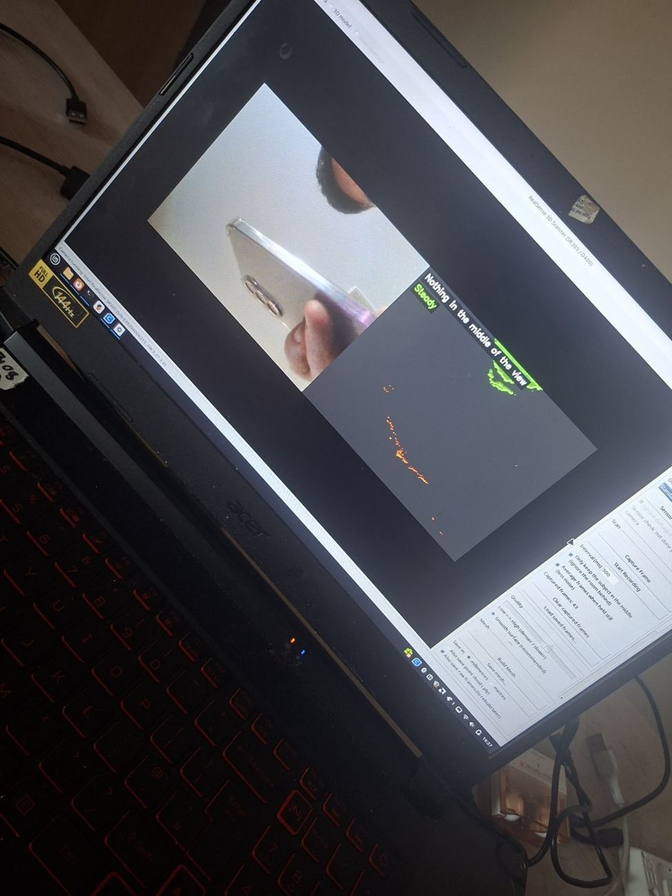

# 2. How a depth-camera scanner works, in two minutes

A depth camera gives you a picture where each pixel says **how far away** that bit of the world is, as well as
**what colour** it is. One such picture is a **frame**: a patch of 3D surface seen from one side.

To scan a whole object you take frames from all round it (moving the camera, or turning the object), then:

1. **Clean each frame.** Throw away the unreliable pixels: the "flying pixels" along outlines, readings too near or too
   far, and the room behind the object.
2. **Line the frames up.** Work out where the camera was for each frame, so all the patches land in the same place.
   This is the hard part.
3. **Fuse them.** Every frame "votes" on where the surface is. The noise averages out and one smooth surface is left.
4. **Save a mesh** (STL, OBJ or PLY) for a slicer, Blender or FreeCAD.

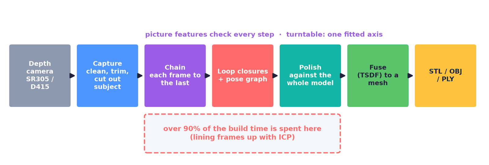

**Lining up, in one paragraph.** The standard tool is **ICP** (Iterative Closest Point): slide one frame over another
until each point sits as close as possible to the other frame's surface. It's excellent when the frames start close
together, and it's fooled by smooth or symmetric shapes. A ball fits a ball in any orientation. A plain box fits itself
four ways round. You chain frame 1 to 2, 2 to 3 and so on, then add **loop closures** (frame 20 also overlaps frame 1:
tie them together) and let a **pose graph** spread out the leftover error. Each wrong link in that chain is a doubled
surface in the final model.

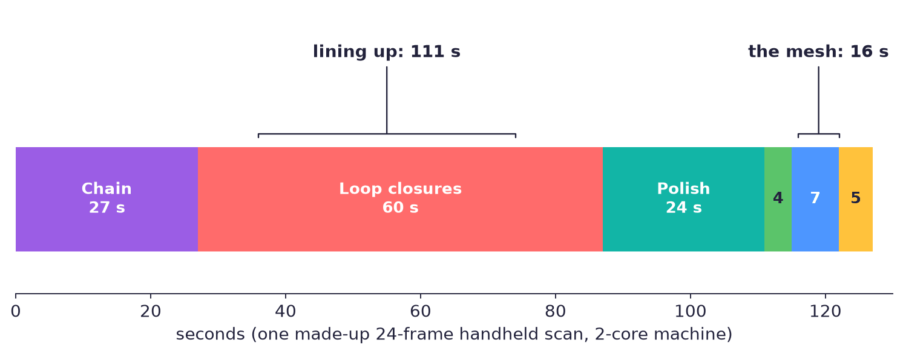

# 3. What already exists

This is a well-studied problem. What follows is a hobbyist's search, not a professional one, and **not legal advice**.

| What | What it does | Why Scantastic didn't just use it |
|---|---|---|
| KinectFusion (Newcombe et al., 2011) [1] | Live tracking against a fused volume, on a graphics card | Needs a GPU; the volume is the depth fusion Scantastic uses *after* lining up |
| ElasticFusion, BundleFusion and similar [2] | Dense live reconstruction with loop closure | GPU-only; research or non-commercial licences |
| ORB-SLAM3 [3] | Feature-based SLAM: keyframes, relocalisation, loop closing | GPLv3, which can't be combined with a noncommercial licence. Its authors offer a paid commercial licence |
| Open3D's reconstruction system (Choi, Zhou, Koltun, 2015) [4], colored ICP (Park et al., 2017) [5] | Fragments, pose graphs, loop closures checked by geometry; ICP that uses colour as well as shape | **Used**: Open3D (MIT licence) is the engine underneath. The checks in section 4 are built on top of it |
| Visual-plus-geometric loop-closure checks (e.g. Aalto, ICIP 2016) [6] | Accept a loop closure only if image features and shape agree | Same family of idea as section 4.5; the details differ |
| Commercial turntable scanners and photogrammetry rigs | Turntables, often with printed marker mats, to know each turn | Closed software; the marker idea itself is old and well known |
| Patents found with titles close to this work | e.g. scanning an object turned in the hand (US 9,639,943 B1) [7]; power-efficient depth sensing for live reconstruction (US 9,443,350 B2) [8]; turntable scanner calibration (US 2003/0202691) [9] | **Not assessed.** Listed so readers can look. Nothing here is a claim about what they cover |

**The gap Scantastic fills** is not a new algorithm. It's a set of plain, checkable rules that make standard tools
(ICP, ORB features, pose graphs, TSDF fusion) behave on **bad cameras and slow computers**, in a program anyone can
run by double-clicking. Section 9 writes those rules down as prior art.

# 4. The method, in enough detail to rebuild it

All numbers are Scantastic's defaults (0.9.0 to 0.11.0). Distances are in metres at the camera unless they say
otherwise.

## 4.1 Capturing a clean frame

- **Depth confidence** can be set stricter for a worn or scratched window ("Strict (worn / scratched glass)").
- **Edge trim.** Pixels next to a sudden depth jump are dropped: 2 pixels on the SR305, 5 on the D400s, whose outlines
  are softer.
- **Cut out the subject** (on by default). Keep the surface nearest the camera in the middle of the view, plus
  everything joined to it without a depth jump, within a slab of depth. The room goes. *Why:* without this, a still
  room dominates the alignment. Turn yourself in front of a fixed camera and the room "doesn't move", so the frames get
  lined up to the room and the face comes out doubled. (This is the "second nose" in section 6.)
- **Average when still.** If the camera has hardly moved (under 1 pixel of shift and 1.5 mm of depth change), up to 5
  frames are averaged into one capture, pixel by pixel. A pixel from an earlier frame is only used where it agrees.
- **Speed hints** on the live picture: "Steady", "Moving quickly" (over 150 pixels a second at 640 wide) and "Too fast -
  slow down" (over 350). Coded-light cameras smear when you rush them.
- **Distance colours.** The live depth picture is green in the best band (30 to 50 cm for the SR305, 35 to 65 cm for
  the D400s) and fades to red outside it.

## 4.2 Picture features: a second opinion on every step

The 3D shape can't tell a ball from a rotated ball, but the **pattern on it** can. So every frame also gets:

- up to **1,500 ORB keypoints** (corners in the picture), found on a contrast-boosted greyscale copy (CLAHE);
- keypoints kept only where there's depth (in turntable mode, also at least 6 pixels inside the depth outline:
  outline points sit half on the still background and say "nothing moved");
- each keypoint **lifted into 3D** with its depth.

For two frames, keypoints are matched with **Lowe's ratio test at 0.9** (0.8 kept too few right matches on plain
objects), then a **RANSAC rigid fit**: the 3D motion that the most matches agree with, to within 6 mm. That gives a
camera move with a **confidence** that rises from 0 at 12 agreeing matches to 1.0 at 52.

That estimate is the second opinion. It's used three ways:

1. As **one more starting guess** for ICP.
2. As a **veto**: if the pictures are confident (0.5 or more) and ICP's answer is more than **2.5° or 12 mm** away from
   theirs, ICP is wrong (a smooth surface fitting itself in the wrong place), and the frame is placed where the pictures
   say, then fine-tuned from there.
3. As a **vote** in loop closures (section 4.5).

## 4.3 Chaining frames, with guards

Each new frame is aligned to the last frame that worked:

- **Starting guesses:** the tracker's or pictures' guess (if any), "the same move as last time", and "no move". ICP
  (colour ICP, matching within 8.7 mm at the default quality) runs from each; the one with the best two-way overlap
  wins. Two-way means checking that frame A's points find frame B's surface **and** B's find A's: a frame full of
  noise, or of the whole room, finds *something* near almost every point one way, but not the other way round.
- **If that's weak** (under 60% overlap), the slower **feature-based global alignment** (FPFH + RANSAC) is tried too.
- **If it's suspicious** (overlap under 60%, or the surfaces sit more than 1.6 times further apart than usual) **and the
  pictures don't vouch for the step**, the frame is also tried against 6 earlier frames spread across the scan. The
  closest fit wins. This is how a quick swing back to the start re-attaches there.
- **If nothing fits but the pictures are sure,** the picture estimate is used and fine-tuned.
- A frame that fits nothing (under 35% overlap) is **skipped**, not glued on somewhere wrong.

## 4.4 The room check, for plain objects

A plain white box or mug gives the pictures almost nothing to match. But **the room behind it doesn't move**. So in
handheld mode, each frame also keeps a thinned (6 mm) copy of the whole view, before the subject was cut out. When the
pictures can't vouch for a step:

- the two whole-room views are aligned coarse to fine (30, 15, then 8 mm), from each starting guess;
- a fit counts only with at least 60% overlap and under 4 mm average error;
- tables and walls are flat and slide over each other, so among the fits that pass, the one **most picture matches
  agree with** wins;
- if the room says the object's own fit is more than 2.5° or 12 mm out, **and** at least as many picture matches side
  with the room, the room wins.

**The same pictures catch a classic mistake.** If they say the camera hardly moved for most steps (under 1° and 3 mm)
while the shape says it did, the object was turned by hand in front of a still camera. The pictures are right about the
room and wrong about the object. They're not allowed to overrule, and the report suggests Turntable mode.

## 4.5 Loop closures on a leash

Loop closures are where the 0.9.0 work found its worst errors. On a plain made-up blob, **40 of 42 accepted closures
were wrong**, by tens of degrees: a smooth surface happily fitting itself in the wrong place, with plenty of overlap.

The candidates are: frames 2 to 4 steps apart, every frame against the first, and up to 4 earlier frames seen from
within 30° and 20 cm (a "revisit"). Each is aligned (coarse plain ICP at 4 times the match distance, then colour ICP),
and kept only with at least 50% two-way overlap and a surface error under 1.6 times the scan's typical step. Then:

1. **Confirmed by the pictures?** At least 12 picture matches agree with the closure **and** the pictures don't back
   their own best estimate clearly better than this closure (0.10.0: a dozen chance matches had "confirmed" closures
   18-24° out). Then it's in.
2. **Not confirmed?** It may only move a frame as far as the chain could have drifted:
   - at most **2° + 0.25° for every step in between that the pictures vouched for + 5° for every step they couldn't**;
   - at most **8 mm + 2 mm per vouched step + 30 mm per unvouched step**.
3. **Either way**, if the two frames' own picture features disagree with the closure by more than 2.5° or 12 mm, and
   either the tracker's or the pictures' estimate for that pair was confident, or the pictures clearly prefer their
   own answer, it's out.

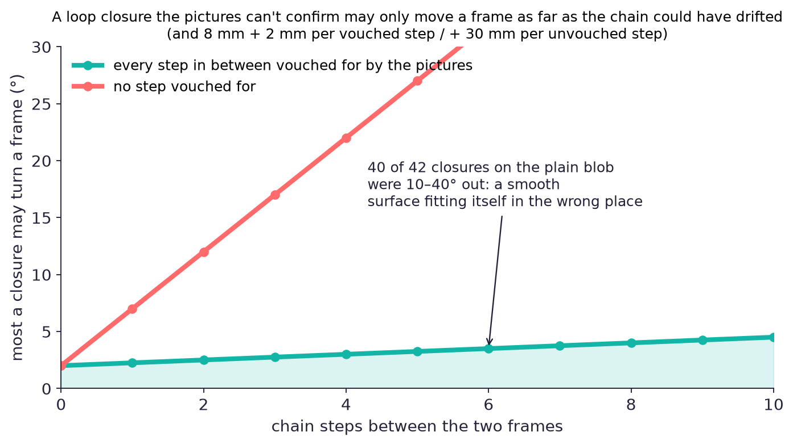

## 4.6 Polish, and leaving out what moved

- **Pose graph** (Open3D's Levenberg-Marquardt optimiser) spreads the leftover error over the chain.
- **Polish (handheld):** every frame is aligned again against the model made from all frames together, in two
  passes.
- **Frames that disagree** with their neighbours (median point-to-plane offset over 2 times the scan's typical offset,
  and more than 0.8 mm) are left out, never more than 40% of them.
- **Areas that moved** (a blink, a mouth, a hand passing through, or a sensor defect that puts a bump at a fixed place in
  the image) are cut out of just that frame: a patch at least 25 points big, over 3 times the typical offset and 3 mm
  away, but under 35% of the frame. The other frames still cover it.

## 4.7 Turntable mode: one axis to rule them all

With the camera on a stand and the object on a turntable, **every step is a turn about the same line**. Scantastic
uses that hard:

- **Remove what stands still.** Either record the empty turntable first (any pixel within 8 mm of the empty scene is
  background), or find the table plane and, on top of it, the **turntable's top**: a flat layer parallel to the table
  and wider than the object. Left in, the turntable top looks identical at every turn and pulls every step short.
- **Picture features on the object only.** Keypoints near the object's outline are dropped in turntable mode (they sit
  on the still background and said "nothing moved").
- **Fit the axis to the steps.** Each step's rotation axis is fitted to one line. A step that doesn't fit is tried
  again at the angle the pictures or neighbouring steps suggest. **Each frame's pose is then just its angle**: the sum
  of the turns before it. One bad step can't bend the rest of the scan.
- **Fine-tune axis and turns together.** Each small step measures its turn well but its axis badly (a 12° turn about a
  line 5 mm away looks almost the same), and on a made-up scan that grew to about 6 mm on the far side of the object. So the axis (4
  numbers) and every frame's turn are fitted together by Gauss-Newton on point-to-plane distances, using each frame
  and its 4 nearest frames within 45°, with each turn held near what its step measured.
- **Close the full turn.** When the scan goes all the way round, the last frames are also matched to the first and the
  angles are solved again with those closures in, so a little error per step can't add up to a gap.
- **If the steps don't fit one axis** (more than 3 mm from it), the scan is treated like a handheld one instead.
- **No free polish.** The handheld polish lets each frame move freely in any direction. On turntable scans of plain
  objects that undid the axis fit (0.6 mm became 3.5 mm), so turntable scans skip it.
- **Optional marker ring.** A printed ring of ArUco markers lies on the turntable around the object. The object turns
  with the ring, so the ring's pose in each frame gives the turn directly.

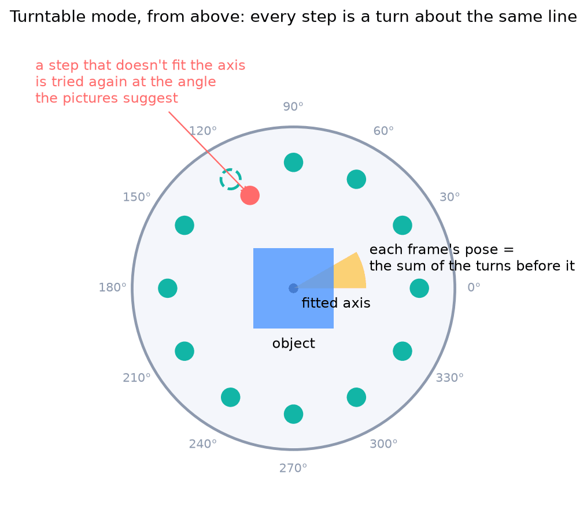

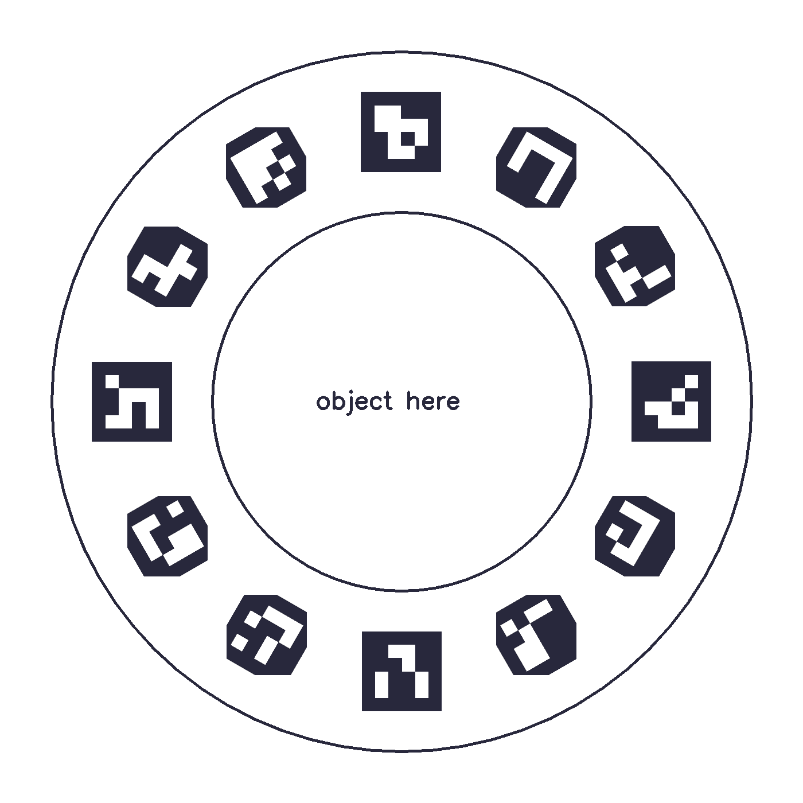

## 4.8 Live tracking: knowing you're lost while you can still do something about it

Version 0.10.0 added the parts of SLAM that help here (keyframes, and finding the way back when lost), written from
scratch on OpenCV's ORB features, so the licence stays the same:

- **Keyframes.** Each live picture is matched to the current keyframe, not the frame before, so small errors don't
  pile up. A new keyframe is taken after 8°, 4 cm, or when fewer than 60 features still match. 40 recent keyframes are
  kept.
- **Finding the way back.** When a picture can't be matched (camera covered, swung away), the tracker tries recent
  keyframes, then a spread of older ones.
- **TRACKING LOST** appears on the live picture while it's lost.
- **Each capture starts where the tracker said the camera was.** These guesses carry where they came from and which
  **track** (one START to STOP, or one recording) they belong to. Guesses from two different tracks are never compared:
  the object may have been turned over in between. Live guesses may overrule ICP at 2.5° / 12 mm; an older recording's
  chained guesses drift more and keep a looser 6° / 4 cm.
- **The camera thread only copies and queues.** Captures are worked out on their own thread, at most 2 waiting. If the
  PC falls behind, a capture is skipped with a message rather than freezing the live picture.

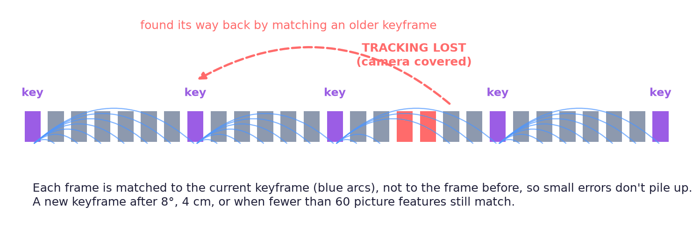

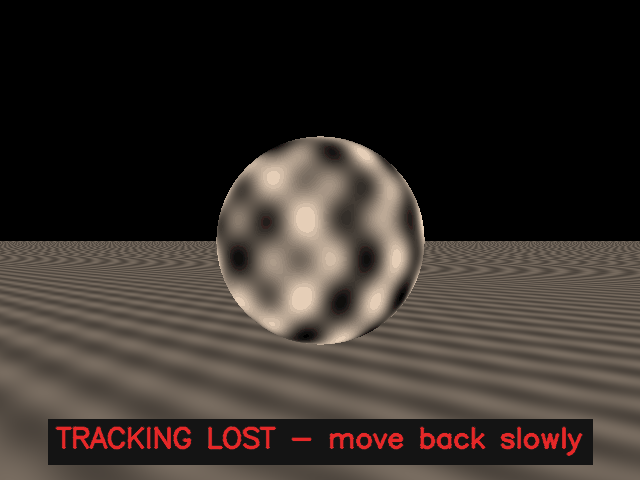

## 4.9 Slow PCs: slow, but never falling over

On a slow PC such as a 7th-gen i3, stitching while you scan should starve the camera: frames drop and the picture
freezes. (Expected from timings on a 2-core test computer; not yet tried on a real i3.) So there are two **scan
styles**:

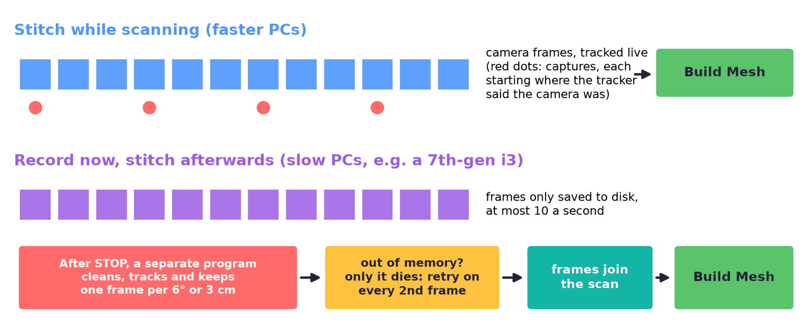

- **The speed check.** The first time it starts, the app times one tracking step on a made-up 640 × 480 picture. With
  4 processor threads or fewer, or a step slower than 150 ms, it picks **"Record now, stitch afterwards"**. You can
  change it.
- **Recording** saves the camera's frames to disk at most 10 a second, using the same cleaned depth a live capture
  would get. The frame list (`frames.json`) is rewritten every 10 frames (every 50 on long recordings), to a temporary
  file that then replaces the old one, so a crash leaves a usable recording minus its last few frames.
- **Stitching** runs in a **separate process** after STOP. It cleans the frames, follows the camera through all of them
  with the live tracker, and keeps **one frame per 6° or 3 cm** of movement. On a made-up 116-frame recording,
  aligning every frame took 14 minutes on the 2-core test computer; the 48 frames worth keeping took 4.
- **Memory budget:** at most 30% of free memory at 5 MB a frame, never fewer than 40 or more than 300 frames. A longer
  recording is thinned to every n-th frame to fit.
- **If it dies**, only the stitching process dies. It's started again on every 2nd frame, twice at most. A process that
  dies before doing any work isn't blamed on memory. The recording stays on disk whatever happens. Build Mesh turns
  into Cancel while it runs, and the status bar shows the minutes left.

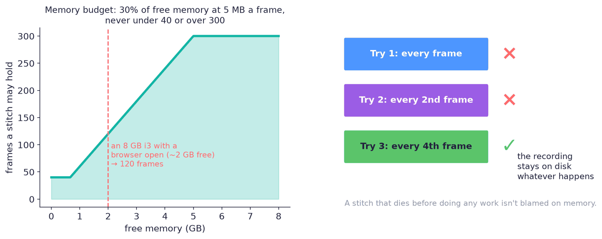

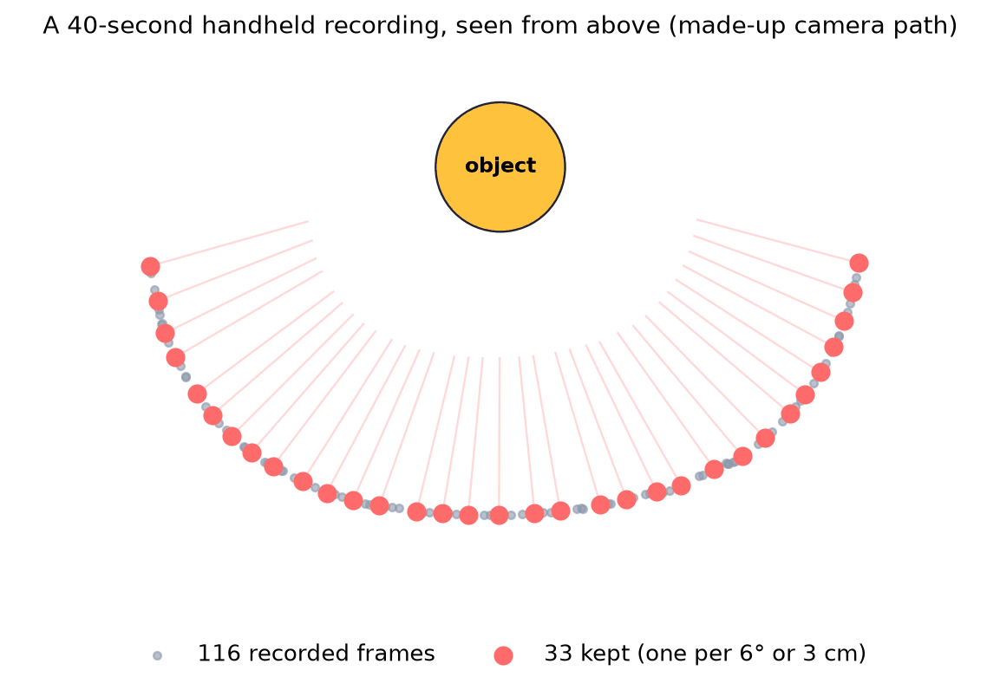

## 4.10 Speed profiles, side-by-side alignment and the graphics card

Version 0.11.0 brought over the speed profiles from my STL-to-STEP converter, then measured what actually helps here.

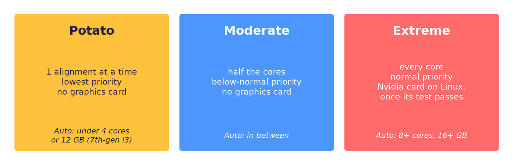

- **Priority.** Building and stitching run at **low priority** on Potato ("nice 10" on Linux and macOS, "idle" on
  Windows), so the computer should stay usable. It makes nothing faster; it stops the build hogging the computer.
- **Alignments side by side** (Moderate, and Extreme when no graphics card is in use: with a card, alignments queue on
  it one at a time). The loop-closure alignments are independent of each other, and so are
  the starting guesses of one chain step. Helper processes, each holding its own copy of the frames, run them while the
  main build process works through them too. Answers are put back in the original order and the checks then run in that
  order, so **the result is the same** (largest pose difference measured: 3 × 10^−13^, which is Open3D's own last-digit
  noise).
  - A helper ends when its pipe breaks or a watchdog sees the builder gone (Cancel).
  - A helper that dies or fails a task only costs time: the builder does that task itself.
  - The number of helpers is cut to fit in half the free memory (300 MB plus 1.5 times the frames each).
  - Each process gets two Open3D threads per core's share.
- **Exactly-the-same polish, quicker.** Colour ICP works out a colour gradient for every point of the target, from its
  neighbours within 2 times the match distance, **on every call**. In the polish the target is the whole model, and each
  frame only sees part of it. So only the model within **5 times** the match distance of the frame is used. Points
  further than 3 times can't change the answer. If the frame moved more than the spare 2 times, or the answer scores
  differently against the whole model, it's redone on the whole model. Poses matched the uncropped run to 10^−14^; the
  polish took 18 seconds instead of 24 on one made-up scan.
  - *What the three margins are for:* matches are only made within 1× of a point; each point's colour gradient
    looks 2× further; so nothing beyond 3× can change the answer. 5× leaves 2× to spare for the frame moving.
- **Repeatable fallback.** The feature-based fallback alignment uses random sampling. It's now seeded, so the same
  frames always give the same answer.
- **The graphics card, with a gate.** Open3D's newer "tensor" ICP and depth fusion can run on an Nvidia card (CUDA). The
  standard Open3D for Linux already contains that part. Before a card is used, a separate process runs **the actual
  steps** (colour ICP between two small made-up surfaces, and a depth fusion) on the card and on the processor, and
  they must agree to 0.5 mm. During a build, any card error (out of memory, a driver fault) switches the card off and
  the processor redoes that step; an error is never mistaken for "these frames don't overlap".
  - Not used: Nvidia on Windows (Open3D's Windows CUDA build is a preview), Apple graphics (Open3D has no Metal
    support), AMD and Intel graphics.

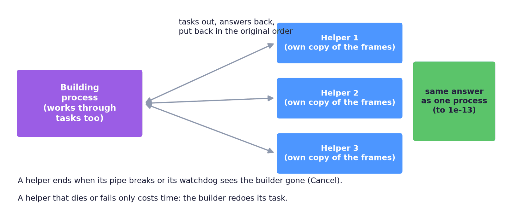

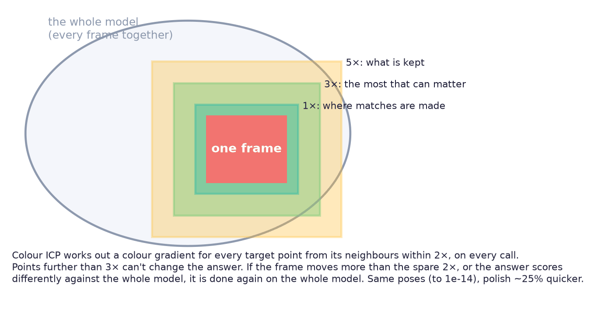

## 4.11 The sensor check: mapping a scratched window

Point the camera at a plain flat wall, hold still, and the app collects 30 frames. A flat wall seen by a pinhole camera
has **1/depth changing in a straight line across the picture**, so a smooth low-order fit of 1/depth is the "true" wall.
That fit also absorbs lens distortion and a slightly bowed wall. (The fit is repeated with the worst pixels left out;
the written breakdown in the report uses an even more outlier-proof fit from 2,000 random trials.) A scratch then
stands out from it in one of three ways. These are the limits for pixels that get **ignored while scanning**:

| Fault | Ignored when (scaled to 40 cm) | Shown as |
|---|---|---|
| **Flicker** | a pixel's noise is over 2.5 times the typical noise, and over 1.5 mm | red on the noise map |
| **Steady offset** | a pixel is off the wall by over 5 times the typical spread, and over 2 mm | red (too far) or blue (too near) on the offset map |
| **No depth** | enclosed holes up to 5% of the view, and pixels that lose their depth more than a quarter of the time | purple |

The report's written diagnosis is more sensitive: it already counts an offset of 3 times the typical spread.

The marked pixels can then be **ignored while scanning**, all of them or only the no-depth ones, and shown live in
magenta.

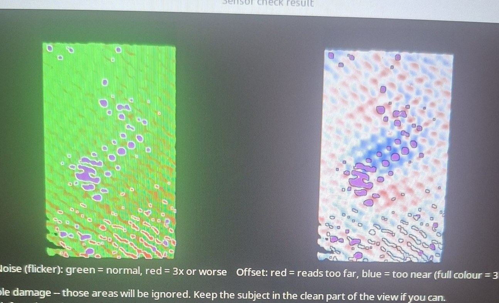

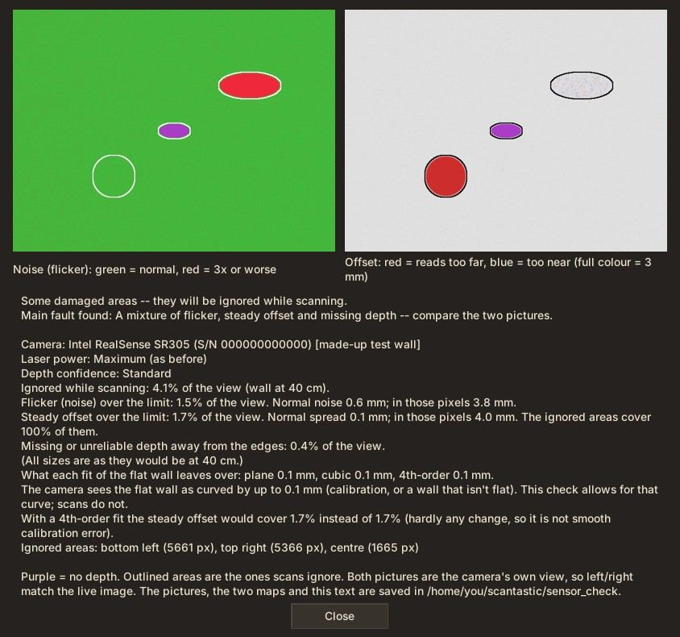

## 4.12 From frames to a mesh

- **Smooth surface (default):** TSDF fusion in an Open3D VoxelBlockGrid, sized from the scan itself because it reserves
  its memory up front. On the SR305 the grid follows the Quality slider (2.5 mm at Low, about 1.5 mm in the middle,
  1 mm at High) and is smoothed with 5 Taubin passes; the D400s start at a fixed 1 mm grid and 2 passes. Surface seen in
  only one frame is dropped when there are enough frames.
- **Watertight:** Poisson reconstruction, trimmed back to within 2.5 grid cells of a scanned point.
- **The 3D preview** is coloured by how many frames saw each area, so thin spots show before you print.
- **Cut and make solid:** draw a line across the model to cut it, or let the app find the table. "Make solid" closes an
  open scan by inside-outside voting along 9 directions.

# 5. A tour of the app

**These screenshots come from the app itself, running on made-up data**, because the camera wasn't at the computer the
paper was written on. They show version 0.10.0's window; 0.11.0 adds the Speed and graphics card box.

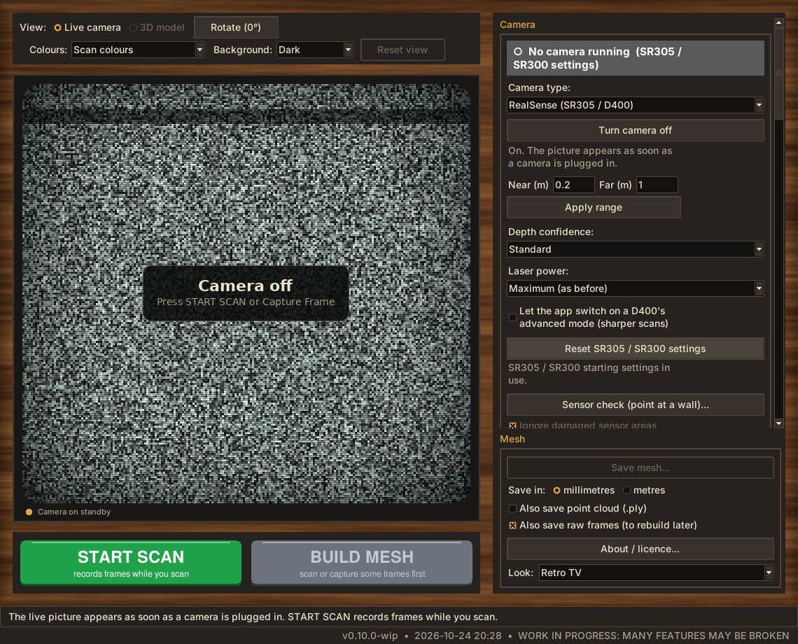

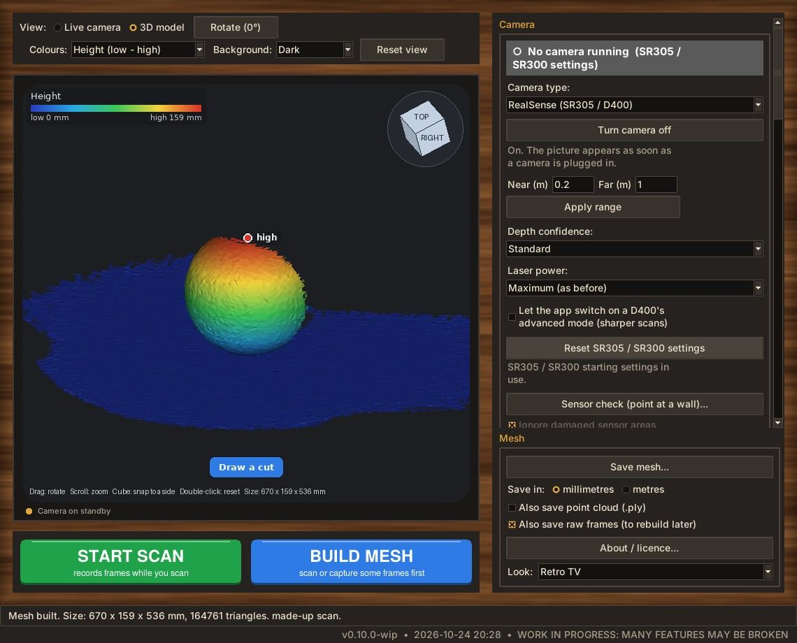

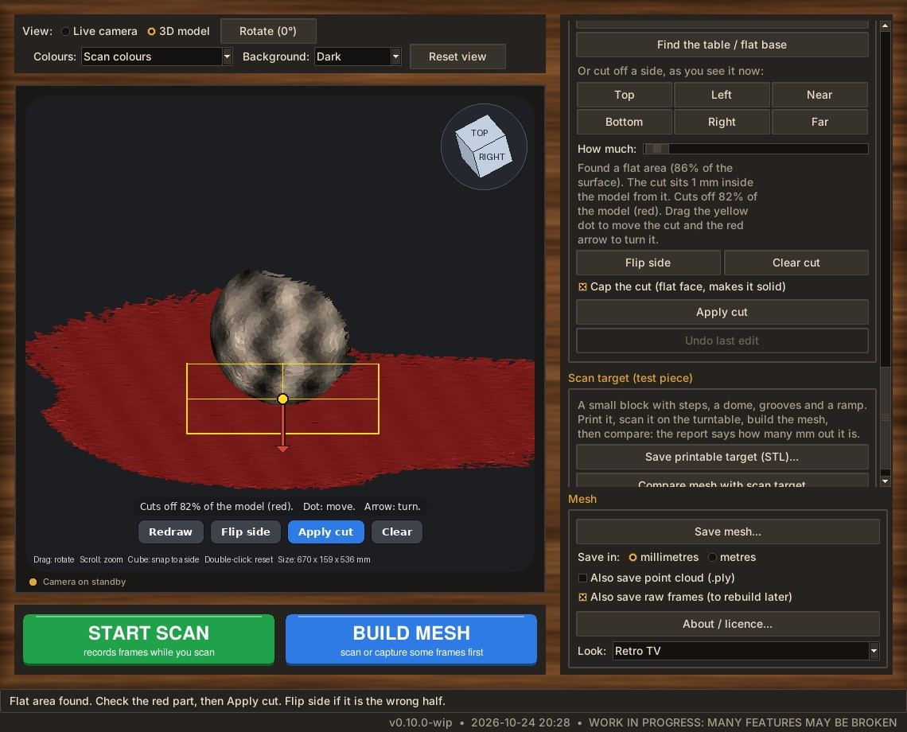

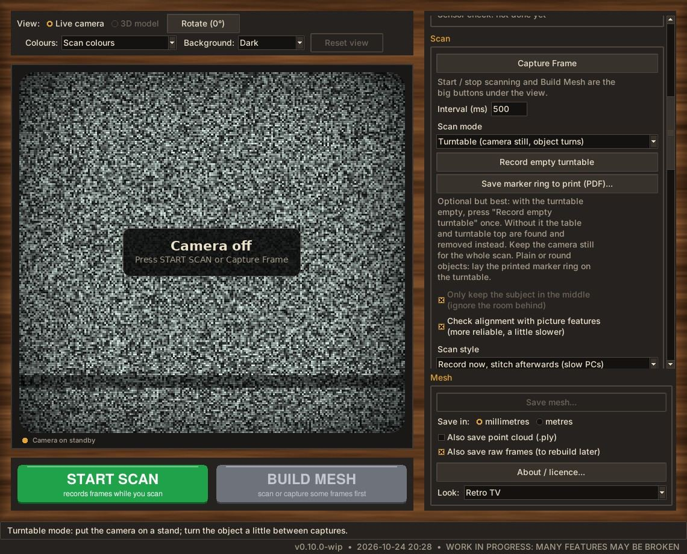

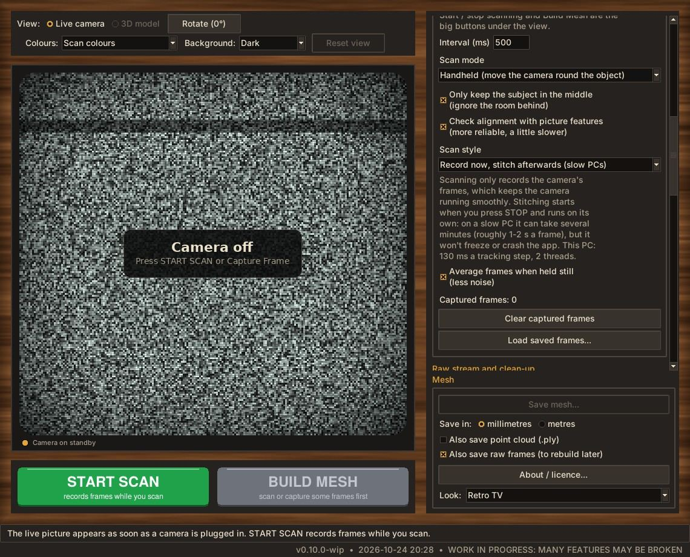

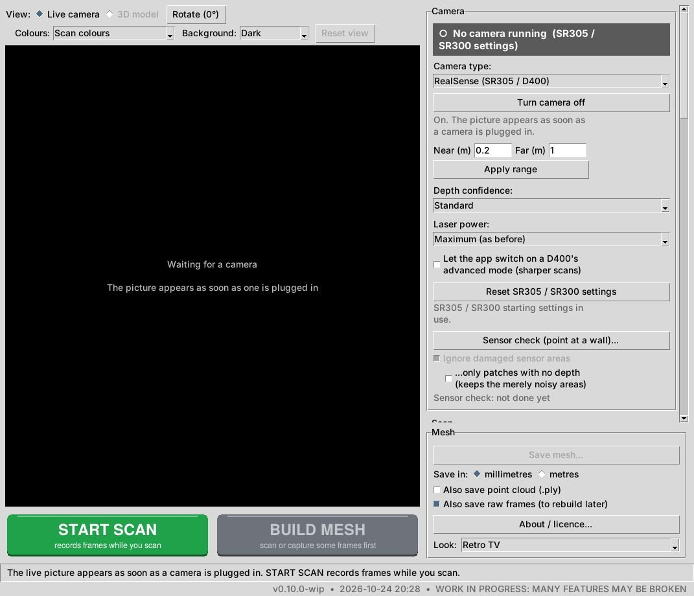

# 6. The mistakes, for free

Every one of these happened. Most were caught by measuring, a few by a separate reviewer, and some by the owner of the
camera.

| What went wrong | What it looked like | The fix |
|---|---|---|
| The room was in every frame | A still room "won" the alignment, so turning in front of the camera gave a **second nose** | Cut out the subject (4.1) |
| A setting from an older Open3D | The fallback alignment's RANSAC got a "confidence" of 500, so it never stopped early: 400,000 iterations, every time | Proper (iterations, confidence) values |
| Open3D 0.20's one-line hole filling | Handed back vertices from memory that had already been freed: garbage in 19 of 30 tries | Keep every step alive and copy the arrays out: 0 of 30 |
| An outline trim made for the D415 | Silently cut 20% of the points from every SR305 frame | Trim per camera (2 px SR305, 5 px D400) |
| Loop closures on smooth shapes | 40 of 42 accepted closures on the plain blob were tens of degrees out | The drift rule (4.5) |
| Picture keypoints on the outline (turntable) | Background corners said "nothing moved", so every turn came out short | Drop outline keypoints, turntable only (it broke handheld scans when done there too) |
| The turntable's own top | Looks the same at every turn: pulled every step short | Find it and remove it (4.7) |
| The axis from small steps | About 7 mm out, 6 mm of error on the far side | Fit axis and turns together (4.7) |
| The free polish on turntable scans | 0.6 mm became 3.5 mm on the plain scan target | Turntable scans skip it |
| A dozen chance picture matches | "Confirmed" loop closures 18-24° out | Confirmed only if the pictures don't prefer their own answer (4.5) |
| The older recording tracker | One bad link put every later frame 0.7 m out, while reporting 0.65 confidence | Stitching uses the keyframe tracker |
| Aligning every recorded frame | 14 minutes for one 116-frame recording | Keep one frame per 6° or 3 cm: 4 minutes |
| Open3D 0.20 on Apple-silicon Macs | Needed Homebrew's libusb: "Library not loaded" | Macs use Open3D 0.19 (figure below) |
| A graphics-card error | Treated as "no overlap", so frames could be dropped silently | Switch the card off, redo on the processor |
| Helpers after Cancel | A busy helper kept running | A watchdog ends it within a second |
| A result file for 0.10.0 | Said 0 of 20 failed. Run again, the shipped code fails 1 of 20 | Corrected in 0.11.0's notes; the rerun is published next to it |

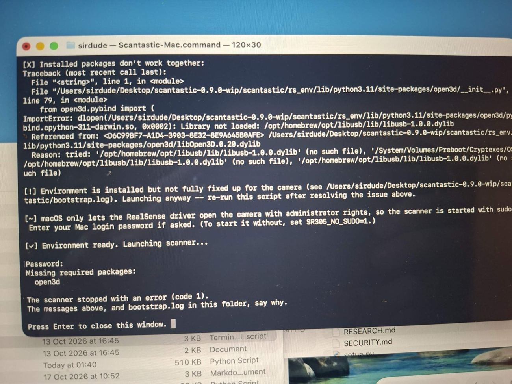

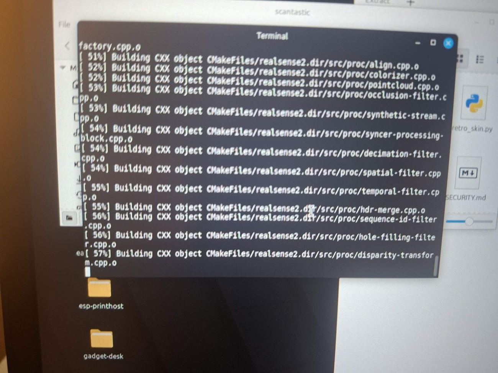

# 7. The numbers

**Everything in this section comes from made-up scans** with known answers (a benchmark that renders 5 objects with
rich and plain patterns, with an SR305-like noise model, from known camera paths). A scan **fails** if any kept frame
lands more than 3 mm from where it should. Tuning used seeds 0-1; the held-out seeds 1000-1001 were only used to check
finished code. Times are on a 2-core cloud computer.

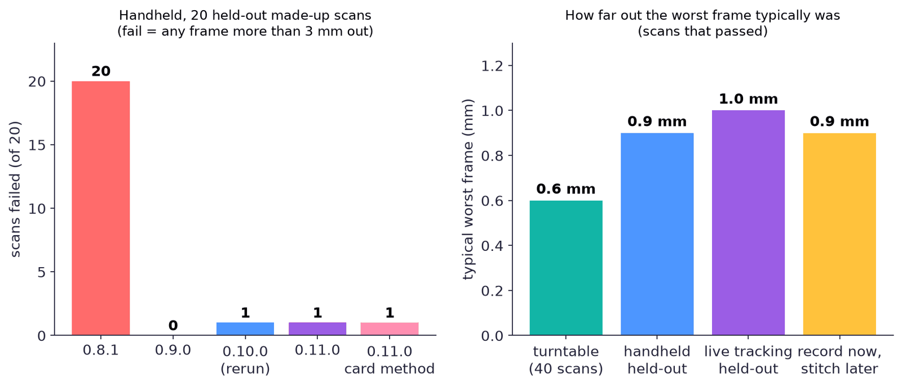

| Version, mode | Failed | Typical worst frame |
|---|---|---|
| 0.8.1 (before this work), handheld and turntable | every scan | — |
| 0.9.0 turntable (tuning + held-out) | 0 of 40 | 0.6 mm |
| 0.9.0 handheld, held-out | 0 of 20 (as recorded then; not re-run) | 0.9 mm |
| 0.10.0 live tracking (tuning + held-out) | 0 of 20 each | 1.0 mm |
| 0.10.0 record now, stitch later, held-out | 2 of 20 (one stray frame each, 6-8 mm) | 0.9 mm |
| 0.10.0 handheld held-out, re-run | 1 of 20 (the plain blob, 3.1 mm) | 0.93 mm |
| **0.11.0 handheld held-out** | **1 of 20, the same scan, identical answers on all 20** | **0.93 mm** |
| 0.11.0, graphics-card code run on the processor | 1 of 20 (the same scan) | 0.88 mm |

**Speed, honestly.** On a 7th-gen i3, expect **several minutes** from STOP to a mesh (estimated from the 2-core test
computer, which is in the same range; not timed on a real i3). The 0.11.0 speed-ups are small
on 2 cores: the polish about a quarter quicker, loop closures about 10% quicker with one helper. More cores and a
graphics card should help more, but **neither has been measured**.

# 8. A test plan, for anyone with a depth camera

If you have an SR305, SR300, a D400-series camera or a Prowise MOVE 3in1, please try these and report back (an issue
or discussion on the repository, with photos):

1. **Sensor check** on a plain wall at 40-50 cm. Post both maps and the percentage.
2. **Scan target.** Print the app's 70 mm test block, scan it in Turntable mode, and use "Compare mesh with scan target".
   It reports the error in millimetres.
3. **Turntable, with and without the printed ring**, on a plain object (a mug) and a patterned one.
4. **Handheld, both scan styles**, on the same object. Note the time from STOP to mesh and whether TRACKING LOST
   appeared.
5. **A slow PC.** On a 7th-gen i3 or similar: does "Record now, stitch afterwards" get picked, does it finish, and does
   the computer stay usable while it works?
6. **A many-core PC or an Nvidia card on Linux:** Potato against Extreme, same scan, time to mesh.

# 9. Defensive disclosure

This section is written to be read as prior art. It describes methods implemented in Scantastic (versions 0.9.0 to
0.11.0, source published at the repository below), and variations of them. **All of them are dedicated to the
public.** Anyone may use them, free, for any purpose. The purpose of publishing them is to make it hard for anyone to
patent them and restrict their use. Where a number is given, any other value that does the same job is also disclosed.
**Not legal advice.**

**D1. Choosing between live stitching and record-then-stitch by measuring the computer.** On first start (or on
demand) the software times a representative step of its own live processing (feature extraction and matching on a
synthetic image; or any other step of the real pipeline) and reads the processor thread count (or, as a variation,
memory too). Below a threshold it selects a mode where scanning only records frames (optionally pre-cleaned, rate-limited) and all
alignment runs afterwards. The choice is shown to the user with an expected-time warning, and the user can override it.
Variations: re-measuring periodically or while scanning; switching modes mid-scan when frames start to drop;
thresholds on battery state, temperature or other load; recording at reduced resolution; recording only frames that
pass a motion or sharpness test.

**D2. Crash-tolerant deferred stitching.** The deferred alignment runs in a separate operating-system process with a
frame budget derived from free memory (a share of it divided by a per-frame cost, clamped to limits). If the process
dies, it is restarted on a subsampled set of frames (every 2nd, then every 4th; or any decreasing subset), a bounded
number of times. A process that dies before reporting any progress is treated as a different failure from running out
of memory. The recording's index is written atomically (to a temporary file, then renamed) at a decreasing frequency
as the recording grows, so a crash loses only the last few frames. Variations: splitting the recording into
overlapping chunks that are stitched and then joined; spilling to disk; any other subset rule (by motion, by time, by
sharpness).

**D3. Motion-based thinning before global alignment.** A lightweight tracker follows the camera through every
recorded frame; only frames that have turned or moved more than a threshold (6° or 3 cm; or any other threshold,
including one adapted to the object size or the overlap) from the last kept frame are passed to the expensive
alignment, together with their tracked poses as starting guesses. On a turntable, a fixed number of frames spread
evenly over the turn.

**D4. Track-scoped, source-weighted pose priors.** Each starting guess carries its source (live tracker, recording
tracker, picture features, marker ring) and a track identifier. Guesses from different tracks are never compared or
chained. The tolerance with which a guess may overrule a shape-based alignment depends on its source (tight for a
keyframe tracker, loose for a drifting frame-to-frame tracker). A guess with low confidence is replaced, for checking
purposes, by an independent pairwise estimate from the two frames' own picture features.

**D5. Drift-bounded loop-closure acceptance.** A loop closure between two frames is accepted without image-feature
confirmation only if it moves the frame by no more than a bound that grows with the number of chain steps between the
frames, with a small allowance per step that image features vouched for and a large allowance per step they couldn't
(2° + 0.25°/vouched + 5°/unvouched, and 8 mm + 2 mm/vouched + 30 mm/unvouched; or any monotonic function of those
counts, step lengths or step confidences). Image-feature confirmation requires both a minimum number of agreeing
matches and that the features do not clearly prefer their own best estimate; and any closure the two frames' own
features contradict is rejected. Variations: the same bound applied to chain steps or relocalisation; bounds expressed
as covariance in the pose graph instead of accept/reject.

**D6. The still room as a referee.** In handheld scanning of an isolated object, a down-sampled copy of the whole
scene (before the object is cut out) is kept per frame. Where image features can't vouch for a step, the scene copies
are aligned coarse to fine from several guesses. Among fits that pass overlap and error thresholds, the one most
image-feature matches agree with is chosen, and it overrules the object's own fit only if the features side with it at
least as much. Also: when image features say the camera stood still while the object's shape says it moved, the
software concludes the object was moved in front of a still camera, stops the features from overruling, and suggests a
turntable mode.

**D7. Turntable poses as one axis plus angles.** With a still camera, every pairwise step is treated as a rotation
about one common axis. The axis is fitted to all steps, off-axis steps are re-tried at an angle from image features or
neighbouring steps, and each frame's pose is the cumulative angle. Axis (tilt and position) and all angles are then
refined jointly by least squares over pairs of nearby frames (each frame's nearest few within 45°; or any other choice of pairs), together with full-turn closures where the scan goes all the way round, with each angle held near its measured
step. A free 6-degree-of-freedom refinement is skipped in this mode, and if the steps don't fit one axis the scan falls back to free handheld-style alignment. Static scenery is removed by an empty-scene
snapshot or by detecting the table plane and a turntable top (a flat layer parallel to and above the table, wider than
the object). Image keypoints near the object outline are excluded in this mode only. Variations: a printed marker ring
giving angles directly (ArUco, AprilTag, coded dots, a printed angle scale); a motorised turntable reporting angles; any
mix of these as priors.

**D8. Exact cropping of the target in colour ICP.** When aligning a frame to a much larger target (a fused model, a
previous scan), the target is cropped to the region within a margin of the frame's starting position, where the margin
is at least the colour-gradient neighbourhood radius plus the match distance plus an allowance for movement (5 times the
match distance in the implementation). The result is accepted only if the frame moved less than the allowance and its
fitness and error, re-scored against the whole target, are unchanged; otherwise the alignment is redone on the whole
target. Variations: caching target gradients instead; tiling the target; any margin derived the same way for other
neighbourhood-based ICP variants.

**D9. Order-preserving parallel alignment with fail-safe helpers.** Independent alignment tasks (loop-closure
candidates, multiple starting guesses for one step) are run in helper processes holding copies of the frames, with the
main process also working, and answers re-ordered to the original task order so the result equals a single-process
run. Helpers are tied to the main process by a pipe and a watchdog; a task that fails in a helper is run only by the
main process thereafter; the helper count is limited by free memory; random number generators used in alignment are
seeded per call so results don't depend on which process ran which task.

**D10. A graphics-card gate made of the real work.** Before an accelerator is used, a separate process runs the same
alignment and fusion steps on it and on the processor with synthetic input, and the accelerator is enabled only if the
answers agree within a tolerance. During use, any accelerator error disables it for the rest of the job and the
affected step is redone on the processor; an accelerator error is never interpreted as a negative result (such as "no
overlap"). The card list shown to the user gives, per card, whether it can be used and why not.

**D11. A flat-wall sensor map for depth cameras.** The camera is held still in front of a flat wall; a smooth low-order
surface is fitted to 1/depth across the image, robustly; pixels are classified as flicker (temporal noise well above
typical), steady offset (bias well above typical spread) or missing (enclosed holes), each with an absolute floor scaled
to a reference distance. The classes are shown as separate maps and can be excluded from scanning, together or
individually. Variations: other reference targets (a sphere, a printed pattern); repeating the check over time to track
wear.

**D12. Live-scanning feedback.** A "tracking lost" banner on the live picture when a keyframe tracker can't place the
current frame; speed warnings from image motion and depth change; distance colouring towards a best working band;
automatic averaging of frames when the camera is still; and captures queued off the camera's thread, bounded, with a
generation counter so cleared scans don't receive stale captures.

**D13. Per-frame removal of areas that moved.** After alignment, a coherent patch of one frame (a minimum point count
and maximum share of the frame) that sits much further from the other frames than the scan's typical offset, while the
rest of that frame agrees, is excluded from that frame only, and the corresponding pixels are excluded from fusion.

# 10. Limits, and what hasn't been tested

- **None of the 0.9.0 to 0.11.0 methods has been run on a real camera yet.** The real photos in this paper are from
  earlier versions.
- All measured results are from made-up scans with a made-up noise model and texture.
- Not run: a real 7th-gen i3, a computer with more than 2 cores, any graphics card, a real out-of-memory death of the
  stitching process, the Windows launcher, a printed marker ring, a printed scan target.
- 1 of 20 held-out handheld scans still fails (a plain blob), and record-now-stitch-later had 2 of 20 with a stray
  frame.

# 11. Credits and how this was made

- **Built on:** Open3D (MIT) [10], OpenCV (Apache-2.0) [11], Intel's librealsense (Apache-2.0), NumPy, Pillow and
  Python's tkinter.
- **Written with help from Claude** (Anthropic's AI assistant), which wrote much of the code, ran the benchmarks and
  drafted this paper. The camera, the scratches, the bug reports from real hardware and the decisions are mine. Every
  number above came from code that was run, and the made-up ones say so.
- **Not affiliated** with Intel, Prowise, or anyone else named here. RealSense is a trademark of Intel.
- Everyone who sends a test result, a correction or prior art I missed will be credited in the next version.

# References

1. R. A. Newcombe et al., "KinectFusion: Real-time dense surface mapping and tracking", ISMAR 2011.
2. T. Whelan et al., "ElasticFusion: Dense SLAM without a pose graph", RSS 2015; A. Dai et al., "BundleFusion", ACM TOG 2017.
3. C. Campos et al., "ORB-SLAM3", IEEE T-RO 2021. <https://github.com/UZ-SLAMLab/ORB_SLAM3>
4. S. Choi, Q.-Y. Zhou, V. Koltun, "Robust Reconstruction of Indoor Scenes", CVPR 2015. <https://openaccess.thecvf.com/content_cvpr_2015/html/Choi_Robust_Reconstruction_of_2015_CVPR_paper.html>
5. J. Park, Q.-Y. Zhou, V. Koltun, "Colored Point Cloud Registration Revisited", ICCV 2017.
6. "Robust loop closures for scene reconstruction by combining odometry and visual correspondences", ICIP 2016. <https://users.aalto.fi/~kannalj1/publications/icip2016b.pdf>
7. US 9,639,943 B1, "Scanning of a handheld object for 3-dimensional reconstruction". <https://patents.google.com/patent/US9639943>
8. US 9,443,350 B2, "Real-time 3D reconstruction with power efficient depth sensor usage". <https://patents.google.com/patent/US9443350>
9. US 2003/0202691, "Calibration of multiple cameras for a turntable-based 3D scanner". <https://patents.justia.com/patent/20030202691>
10. Q.-Y. Zhou, J. Park, V. Koltun, "Open3D: A modern library for 3D data processing", 2018. <https://www.open3d.org>
11. E. Rublee et al., "ORB: an efficient alternative to SIFT or SURF", ICCV 2011; S. Garrido-Jurado et al., "Automatic generation and detection of highly reliable fiducial markers under occlusion" (ArUco), Pattern Recognition 2014.

---

**How to cite:** Armstrong, M. (2026). *Icy Ewe: 3D scanning on the cheap. A hobbyist's field guide and a defensive
publication.* Version 1.1, 13 November 2026 (first published as "Depth Perception", 2 November 2026).
<https://github.com/The-Dorkknight/icy-ewe>

**Software:** Scantastic, <https://github.com/The-Dorkknight/scantastic> (PolyForm Noncommercial 1.0.0;
source-available).

**Licence:** this paper's text and figures are [CC BY-SA 4.0](https://creativecommons.org/licenses/by-sa/4.0/). The
methods in section 9 are dedicated to the public.
